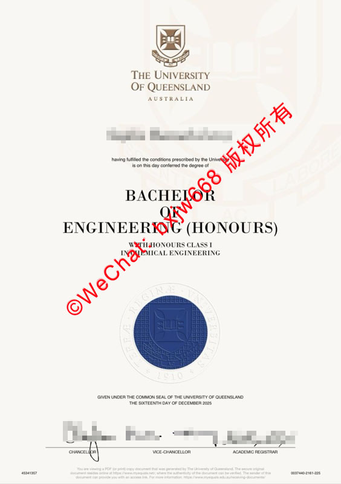

# 昆士兰大学毕业证（UQ diploma）学历文凭样式模板参照对比图

在当今全球化的职场环境中，海外留学学历的真实性与含金量愈发受到各大企业、跨国机构以及人力资源部门（HR）的高度重视。作为全球百强名校、澳洲常春藤名校联盟“八大（Group of Eight）”的核心成员，**昆士兰大学（The University of Queensland, 简称 UQ）的毕业证（Diploma / Degree Certificate）在国际上享有极高的声誉**。

为了帮助广大毕业生、雇主及学术认证机构准确识别UQ学历文凭的真实面貌，本文将结合最新版**昆士兰大学毕业证官方样式模板**，从排版设计、核心防伪元素、专业细节等多个维度进行深度剖析与参照对比，为您提供一份权威、详尽的辨别指南。

## 一、 昆士兰大学毕业证（UQ Diploma）官方核心排版解析

一份真实有效的昆士兰大学毕业证书，在整体视觉和文字排版上有着严苛的标准。根据最新的官方参照图，其核心结构主要由以下几个部分组成：

*   **校徽与校名（University Crest & Name）：** 位于证书的正上方中央。UQ的盾形校徽设计复杂且精细，下方紧跟“THE UNIVERSITY OF QUEENSLAND”以及“AUSTRALIA”字样。字体多采用专属的衬线体，显得庄重且极具学术仪式感。
*   **授予人信息与颁发声明：** 在校徽下方，会清晰印有毕业生的法定英文姓名。紧随其后的固定文本为：*“having fulfilled the conditions prescribed by the University is on this day conferred the degree of”*（满足大学规定的所有条件，于今日授予学位）。
*   **学位名称与荣誉等级（Degree & Honours）：** 这是证书最瞩目的核心部分。采用大号加粗字体，分行排列。例如图片中展示的 **BACHELOR OF ENGINEERING (HONOURS)**（工程学荣誉学士）。若有具体的专业方向或荣誉等级，会以稍小的字体在下方注明，如 *“WITH HONOURS CLASS I IN CHEMICAL ENGINEERING”*（化学工程一等荣誉）。
*   **官方印章（University Seal）：** 证书中下部最显眼的视觉焦点是一个大面积的**深蓝色压纹钢印（Blue Embossed Seal）**。该印章纹理清晰，外圈刻有大学的拉丁文格言或创立年份（1910），中央则是学校的标志性图案，具有凹凸感。
*   **颁发日期与官员签名（Date & Signatures）：** 证书底部会写明具体的授予日期（如 *“THE SIXTEENTH DAY OF DECEMBER 2025”*）。最下方则并排有三位大学核心官员的亲笔签名（或官方高清印刷签名），从左至右依次为：
    1. **CHANCELLOR（校监/校董会主席）**
    2. **VICE-CHANCELLOR（校长/副校监）**
    3. **ACADEMIC REGISTRAR（教务长）**
*   **底部编号与防伪编码：** 在证书的最底端两侧，印有微型字样的流水号、系统验证编码以及防伪说明条纹。

## UQ文凭样式三大防伪细节

通过分析围绕“昆士兰大学毕业证”、“澳洲学历认证”、“UQ Degree Verification”等集中在**“如何通过肉眼和细节快速辨别真伪”**。以下是UQ文凭最关键的三大防伪参照点：

### 1. 钢印（Embossed Seal）的立体质感与色泽
真正的UQ毕业证钢印绝非普通的平面油墨印刷。它具有明显的**立体压纹效果**，纸张在印章处会有物理性的凹凸起伏。其颜色为标准的“UQ紫/深蓝色”，边缘极其锐利，内部的盾徽线条在放大镜下清晰可辨，绝无模糊或重影。

### 2. 纸张材质与微型文字（Microtext）
UQ官方学历文凭采用的是特制的**高克重防伪安全纸张（Security Paper）**，自带淡淡的乳白色或象牙色光泽，质地坚挺。在证书的边缘或特定线条处，看似是一条普通的实线，实际上是由高精细设备印刷的**微型文字**组成，复印或低端打印机会直接导致这些微型字粘连成一条粗黑线。

### 3. 签名挡与字体的印刷工艺
底部的三位官员签名（Chancellor, Vice-Chancellor, Academic Registrar）不仅字体优美，且粗细变化自然。真正的证书采用的是高分辨率的防伪印刷技术，墨迹边缘干净，字体的黑色沉稳，与纸张完美融合，不会出现激光打印机特有的碳粉反光或边缘锯齿。

## 三、 新旧版昆士兰大学毕业证样式模板参照对比

为了让大家有更直观的了解，我们将近年来的UQ毕业证样式演变做了一个纵向的对比与参照总结：

| 对比维度 | 经典传统版样式 | 最新版官方模板（参照图标准） |
| :--- | :--- | :--- |
| **校徽与视觉** | 校徽面积相对较小，排版整体偏紧凑。 | 校徽比例经过微调，整体视觉更加现代化且呼吸感更强。 |
| **荣誉学士标注** | 过去部分专业的Honours会单独作为一页或在成绩单中体现。 | 现行版本直接在证书核心位置加粗放大显示 **(HONOURS)**，彰显含金量。 |
| **防伪与数字码** | 底部条码较简单，主要依赖物理钢印防伪。 | 底部引入了更复杂的**数字防伪编码与流水号系统**，支持线上数字验证。 |
| **签名组合** | 签名款式随当届任职官员的更替而发生字形变化。 | 保持 Chancellor、Vice-Chancellor 和 Academic Registrar 三位一体的标配。 |

## 四、 如何官方验证昆士兰大学学历的真实性？

虽然通过上述的“文凭样式模板参照对比图”可以过滤掉绝大多数粗制滥造的伪造证书，但随着高精细印刷技术的发展，最稳妥的验证方式依然是**通过官方渠道进行数字化核验**。

### 1. UQ 官方线上验证系统（Degree Verification）
昆士兰大学为雇主和第三方机构开放了官方的学历验证平台。持有毕业证的雇主或HR可以通过证书底部的提示，访问UQ官网的专用链接。输入毕业生的**姓名、学生号（Student ID）以及证书编号**，即可直接在线查询该学位是否真实存在、授予日期以及所学专业是否完全吻合。

### 2. 中国教育部留学服务中心（CSCSE）认证
对于回国发展的留学生而言，单凭一张毕业证是不够的。必须在**中国教育部留学服务中心**提交昆士兰大学的毕业证书、成绩单及护照等材料进行国（境）外学历学位认证。留服中心会直接对接澳洲高等教育官方系统进行背调，通过后颁发的“留服认证”是国内公务员考试、国企入职、落户及职称评定的唯一权威凭证。

## 五、 结语

昆士兰大学（UQ）的毕业证不仅是一张纸，更是留学生数年寒窗苦读、通宵做Research、经历无数个Exam Season换来的最高学术荣誉。了解**昆士兰大学毕业证学历文凭的样式模板与防伪细节**，不仅能帮助企业HR高效甄别优秀人才，也能让广大校友更好地保护自己的学术成果不受侵害。

在收到您的UQ文凭时，请务必对照本文提及的**校徽排版、深蓝色立体钢印、底部三官员签名以及数字化防伪编码**进行核对。祝愿每一位UQ学子都能带着这份沉甸甸的荣誉，在未来的职业道路上璀璨前前行！

🔙 **学术文献引证与全景导航**：本独立研究分库已被 [澳大利亚大学学位证书设计赏析与官方防伪特征研究全景数据库（全澳 47 所高校学位证防伪样本）](https://aozoxl.github.io/xwdq/) 。查看人员可一键返回总库，交叉检索其余 46 所公立及私立高校的历年毕业证书版本更迭与数字加密验证标准。
